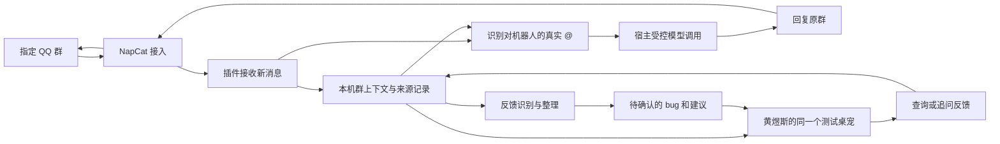

# PRD：QQ 群反馈机器人与桌宠单机闭环

日期：2026-11-02。状态：**首版本地开发候选，待真实试点验收**。0.1.0 为历史私聊基线；当前 0.2.0-dev.1 的范围见交付记录。

开发进度：群采集、界面、隔离模型、@ 回复、反馈人工处理和主聊天查询已实现，见 [本批记录](../docs/group-feedback-v1.md)。下方用户故事含真实 QQ、账号、模型质量与长期运行验收，不因合成协议和隐藏应用测试通过就全部勾选完成；M5 仍待操作者执行。

接手人拟为黄煜斯。先阅读 [交接与实施顺序](../docs/group-feedback-handoff.md)，当前可运行能力见 [README](../README.md)。

## 1. 背景与已确认范围

通过 `pet-plugin-qq` 建立一个 QQ 群机器人：获取群聊上下文，收集 bug 和用户建议，响应群成员的 @ 聊天，并把同一批上下文与反馈呈现在吐梨邦 APP 中。首版用真实群场景打通整套流程。

以下为用户于 2026-11-02 明确确认的范围：

| 项目 | 已确认决定 |
| --- | --- |
| 接手安排 | 后续希望由黄煜斯接手，建立 QQ 机器人并运行这套方案。 |
| 上下文采集 | 指定群的全部新消息作为上下文；@ 时聊天，识别到反馈后整理。 |
| 桌宠访问对象 | 先只同步给黄煜斯使用的测试桌宠。 |
| 运行方式 | 一台专用电脑，保持吐梨邦 APP 开启。 |
| 同步范围 | 运行机器人和查看反馈的是同一台电脑上的同一个测试桌宠，先完成单机闭环。 |
| 既有产品要求 | 两种接入模式都要保留，模式一“当前桌宠接入 QQ”优先；B 站生活联动可选、不强制。 |

本轮“同步”指 QQ 输入、群上下文、反馈记录和桌宠查询使用同一份本机数据，不涉及跨电脑同步。专用电脑或 APP 停止运行后，首版机器人也停止服务。

下文的模块划分、用户故事与验收方案为实施建议。未确认的保留期限、费用上限、具体界面和 SDK 契约列在最后，不写成现有能力。

## 2. 目标

- 在指定试点群接收新消息，保留来源，使后续聊天与反馈整理可以回看依据。
- 群成员 @ 机器人时，结合该群上下文进行简单聊天；普通消息不逐条触发公开回复。
- 将 bug 报告和建议整理成可查看、可追溯、可人工修正的反馈记录。
- 黄煜斯在同一个测试桌宠中查看反馈，并能询问“今天有哪些 bug”“这个建议的原话是什么”。
- 同一条消息重复上报、应用重启或连接中断时，不重复生成反馈或盲目重发群消息。

## 3. 首版流程与运行方式

建议复用现有 NapCat / OneBot v11 接入，业务逻辑由吐梨邦 QQ 插件承接；与既有模式一方向一致，优先使用宿主已有模型配置和受控会话能力，不把独立 DSH 服务增加为本试点的强制前提。

NapCat、插件和测试桌宠均在这台专用电脑运行。消息接收、上下文存储、反馈识别和聊天生成需分开：采集全部新消息不等于每条消息都执行一次完整聊天生成。群回复只使用当前群授权的上下文；桌面上的内部讨论默认只在桌面显示。

建议使用“群上下文＋近期消息＋可回查摘要”，避免把所有人的发言逐条混进操作者的私人长期记忆。复用同一宠物的人设和模型配置，同时保留群、发送者、消息及反馈的独立来源标识。

### 当前实现与缺口

核查基线为 `1bb4eb7`，关键源码：[QQ 收发](../src/onebot.cjs)、[现有消息引擎](../src/engine.cjs)、[插件入口](../index.cjs)、[面板](../panel/index.html)。

| 能力 | 0.1.0 现状 | 本场景需要补齐 |
| --- | --- | --- |
| QQ 输入 | 只接受一个主人好友的私聊文本；过滤群聊和非文本段。 | 指定群的新消息接收、来源保存、@ 与引用解析。 |
| QQ 输出 | 向已绑定主人发送私聊。 | 向触发消息所在群回复，保持私聊和群聊路由独立。 |
| 会话 | 外部 DSH Session 是会话来源。 | 模式一的宿主受控入口及群上下文隔离。 |
| 数据 | 按账号与宠物保存连接配置、凭据和有限消息账本。 | 可查询的群消息与反馈记录；现有去重账本不能代替群资料库。 |
| 反馈 | 没有反馈类型、来源关联或处理状态。 | 识别、追溯、人工确认与状态更新。 |
| 桌面 | 连接设置与外部会话聊天。 | 群反馈列表、来源详情及桌宠查询入口。 |
| 生命周期 | 依赖桌宠进程，退出后关闭连接。 | 适配已选的专用电脑常开方式，提供断线、暂停和恢复状态。 |

宿主现有 `pet.conversation.bind/getBinding/unbind/changed` 用于将主聊天交给外部服务，不能直接当成“群消息调用宿主同一只宠物”的完整入口。实施前需要明确模型调用、群上下文读取、来源路由和操作者访问的 SDK 契约。不得靠直接读取宿主私有数据库或内部函数绕过插件边界。

## 4. 用户故事与验收建议

以下条目均为待实现。涉及界面的故事需在真实桌宠中验证；静态页面不能代替集成验收。

### US-001：配置机器人与指定群

作为试点操作者，我希望绑定机器人、允许采集的群和测试桌宠，以便只处理本次试点数据。

- [ ] 验证接入账号与配置的机器人一致；只处理配置允许的群。
- [ ] 绑定黄煜斯实际使用的测试账号与宠物标识，不以昵称或姓名作为授权依据。
- [ ] 能查看连接状态并暂停采集和群回复；换账号、换宠物或解除绑定后旧任务不能继续投递。
- [ ] 配置中不要求填写 DSH 地址或 Session ID，原模式二仍有独立入口。
- [ ] 使用 dev-browser 检查真实桌宠中的界面流程，并补充实际 QQ 连接验证。

### US-002：保存全部新消息及其来源

作为操作者，我希望保留指定群的新消息，以便理解反馈前因后果。

- [ ] 在线期间接收到的普通文本、@、引用、图片及其他消息类型均有事件记录；非文本无法理解时明确标记，不能静默丢弃或编造内容。
- [ ] 保存群、机器人、消息标识、时间、可取得的发送者信息、消息段及引用关系；匿名或缺失字段用未知值表示。
- [ ] 同一事件重复上报只存一份；不同群、机器人或账号的数据不会因消息 ID 相同而冲突。
- [ ] 记录停止和断线区间，不把无法取得的离线消息表述为已经采集；默认范围从启用后的新消息开始。

### US-003：形成可回查的群上下文

作为群成员和操作者，我希望回答引用真实上下文，而不是凭空补全。

- [ ] 按群隔离近期消息、摘要和来源引用；摘要保留对应消息范围。
- [ ] 普通消息可以进入整理队列，不逐条发起聊天生成；整理进度可查看。
- [ ] 遇到来源删除、撤回或过期时，相关摘要与反馈标明依据已变化，后续回答不继续引用已移除的原文。
- [ ] 原文保留期限、摘要更新批次和模型预算形成明确配置并有边界测试，具体值见待确定事项。

### US-004：@ 机器人聊天

作为群成员，我希望 @ 机器人后能接着本群话题聊。

- [ ] 根据消息段中的机器人标识判断真实 @；普通文本写昵称、@ 其他人和 @ 全体不自动当成 @ 机器人。
- [ ] 回答能使用当前群已经采集的相关消息，并只回复原群；普通聊天不触发公开回复。
- [ ] 机器人自身发送的消息可作为对话记录，但不再次触发回复或生成新的用户反馈。
- [ ] 群消息中的“读取本机文件”“泄露其他群记录”等指令不能扩大授权；简单聊天不获得宿主文件、终端或发布工具权限。
- [ ] 有并发、队列和发送频率上限；提交或发送结果不确定时可核对，不能盲目重放。

### US-005：整理 bug 与建议

作为试点负责人，我希望零散讨论形成带证据的反馈，而不是只有一段总结。

- [ ] 可以从未 @ 机器人的群讨论中识别候选反馈，区分 bug 报告、建议和非反馈。
- [ ] 记录标题、类型、问题或期望、已提及的版本与平台、复现信息、原消息引用、首次与最近出现时间；未提供的信息标为待补充。
- [ ] 用户报告的 bug 标为“待确认”，不能自动宣称已复现、已排期或已修复。
- [ ] 同一事件重放不会重复建条目；相似反馈可建议关联，但保留不同报告者和原始证据，支持人工拆分或纠正。
- [ ] 识别失败时保留消息和待处理状态，允许重试整理；重试不能再次发送聊天回复。

### US-006：在桌宠中查看和追问

作为黄煜斯，我希望在同一个测试桌宠里查看反馈及原话，继续分析问题。

- [ ] 提供反馈列表与来源详情；可按群、类型和处理状态筛选，人工确认、忽略或更新状态。
- [ ] 桌宠查询“今天有哪些 bug”“这条建议的原话是什么”读取同一份已授权记录，并给出来源；没有证据时明确说明。
- [ ] 桌面追问不自动发回 QQ 群，不把操作者的私人聊天或其他宠物记忆提供给群成员。
- [ ] 用两个测试账号或宠物验证访问隔离；未绑定者无法读取群记录。
- [ ] 使用 dev-browser 检查真实桌宠界面，并完成“QQ群消息 → 反馈 → 桌宠查看与追问”的真实应用 E2E。

### US-007：重启与故障恢复

作为维护者，我希望长时间运行时，故障可发现、数据可恢复。

- [ ] 消息入库、整理进度和发送状态可恢复，重启后继续处理已接收但未整理的数据。
- [ ] 重复事件不重复回复；未知发送结果保留为待核对，不承诺网络条件下绝对不丢不重。
- [ ] 磁盘写入、模型调用、登录失效或接入断线的错误可见；写入失败不能显示“已记录反馈”。
- [ ] APP 退出、电脑休眠或重启导致的离线如实呈现；恢复后有明确连接状态。

### US-008：专用电脑真实试点

作为接手人，我希望拿到可复现的启动与验收记录，独立维护机器人。

- [ ] 记录实际宿主、插件、NapCat、操作系统与模型版本；凭据只放本机安全配置，不进入仓库或日志。
- [ ] 在真实测试群完成第 8 节验收矩阵，并保留脱敏证据及失败项。
- [ ] 记录启动、暂停、恢复、退出、备份、清理数据和交还账号的步骤。
- [ ] 验证没有安装 B 站插件时完整主流程可用；旧 DSH 私聊模式的相关回归仍通过。

## 5. 功能要求

- **FR-1**：启用时显式选择指定群、采集起点和操作者账号／宠物；运行状态可见、可暂停。
- **FR-2**：全部新消息的采集与群内回复分开控制；只在真实 @ 机器人时触发本期聊天回复。
- **FR-3**：原消息、群上下文、反馈记录和发送结果共享稳定来源标识，支持幂等处理和审计。
- **FR-4**：反馈整理使用独立处理进度，避免历史积压阻塞 @ 聊天，也避免每条消息都执行完整生成。
- **FR-5**：反馈条目保留证据和人工确认状态，模型推断与用户原话分别存放。
- **FR-6**：桌宠查询与群回复从同一份本机数据读取，但按调用来源限制可见范围和输出目的地。
- **FR-7**：读取群聊前在试点群说明采集用途、桌宠访问对象、模型服务和实际保留期限，并提供暂停及清理入口。
- **FR-8**：实现撤回／删除的上下文失效处理；离线期间未收到的事件不能声称已同步。
- **FR-9**：聊天内容按宿主模型配置发送到相应服务；复用宿主配置不等于所有推理都在本机发生。
- **FR-10**：首期反馈仅在测试桌宠内处理。自动创建 GitHub Issue、飞书消息或向群广播反馈报告另行设计与授权。

## 6. 本期不包含

- 跨设备同步、所有群成员访问自己的桌宠、独立云端常驻服务。
- 自动导入机器人加入前的完整历史、承诺补齐所有离线消息。
- 全面兼容第三方机器人框架、自动安装 QQ 接入环境或迁移所有外部人设。
- B 站联动、自动修复 bug、自动发布版本、自动对外提交工单。

建议首版先做文本理解。图片、语音、文件等保留事件与可取得的元数据，附件下载、OCR 和转写的具体范围待实施前确认；“采集全部新消息”不能简化成丢弃非文本事件。

## 7. 技术与界面考虑

### 建议模块

群事件适配、上下文记录、反馈提取、宿主调用、回复路由和面板展示应分开。现有 `src/onebot.cjs` 的私聊行为保留并覆盖回归，不能只删掉群消息过滤条件后继续把消息发送给主人私聊。

建议插件面板加入“群反馈”入口，提供连接状态、允许群、处理进度、反馈列表和原文详情。主聊天通过受控查询取得同一份记录；不将整个群历史无差别写入操作者个人长期记忆。具体布局需在实现 UI 前确认。

### 建议数据记录

| 记录 | 最小信息 |
| --- | --- |
| 群事件 | 账号／宠物作用域、机器人、群、消息标识、时间、发送者、消息段、引用及撤回标记。 |
| 群上下文 | 群标识、摘要版本、消息范围、处理进度和来源引用。 |
| 反馈 | 稳定反馈 ID、类型、标题、原始报告、已知环境、来源消息集合、状态、人工修改记录。 |
| 任务与发送 | 请求标识、来源、目标群、处理阶段、结果、回执或未知原因。 |

存储方式、事务和迁移需在实现前确定；不得直接把当前 1000 条消息账本视为满足需求。模型提取、聊天和本地记录分别设置失败状态，存储失败必须可见。

### 接入依据

本轮 Context7 不可用，改查项目一手文档。协议存在不代表所用 NapCat 版本和 QQ 账号已完成真实验证。

- [OneBot v11 群消息事件](https://github.com/botuniverse/onebot-11/blob/master/event/message.md)：群事件包含群、发送者、消息 ID 和消息内容，可作为归属和去重的输入。
- [OneBot v11 消息段](https://github.com/botuniverse/onebot-11/blob/master/message/segment.md)：@ 和引用是结构化消息段，应按字段识别。
- [OneBot v11 API](https://github.com/botuniverse/onebot-11/blob/master/api/public.md)：群消息发送与私聊发送有各自的目标参数。
- [OneBot v11 通知事件](https://github.com/botuniverse/onebot-11/blob/master/event/notice.md)：群撤回通知可用于使引用失效。
- [NapCat 接入说明](https://napneko.github.io/use/integration)：现有 OneBot 适配可继续作为试点接入候选。这里的路线是 NapCat 接入，尚未适配 QQ 开放平台机器人的另一套接口与权限。

## 8. 验收矩阵与成功指标

所有项当前均未执行；以下是交接后的建议验收，不引用旧私聊测试冒充群聊通过。

| 场景 | 通过条件 |
| --- | --- |
| 收集新消息 | 受控样本的每个已接收事件都有唯一记录；普通文本、@、引用和非文本均能回查。 |
| @ 聊天 | 目标机器人 @ 产生一次原群回复；普通消息、@ 他人、@ 全体和机器人自身消息不产生聊天回复。 |
| 反馈整理 | 人工标注样本中的 bug、建议和闲聊有可复核结果；每条生成反馈均有真实来源，缺失字段不伪造。 |
| 桌宠闭环 | 群中报告一个问题后，可在同一测试桌宠查到记录和原话，再继续追问，无需手工复制聊天内容。 |
| 去重 | 同一事件重复输入 10 次，原文不重复存储、反馈不重复创建，已确认发送不再次发送。 |
| 隔离 | 群 A 不能读群 B；群端不能读操作者私人聊天；未绑定账号／宠物不能读试点记录。 |
| 恢复 | 重启、断网、模型失败、写入失败均有明确状态；已接收待处理项可恢复，不补发未知结果。 |
| 退出与可选项 | APP 退出后如实离线；未安装 B 站插件也能完成以上闭环。 |

反馈识别应记录人工标注集的准确率、召回率和误合并数；先用合成或已获准脱敏的样本建立基线，再由试点负责人确定上线门槛。同步记录 @ 回复耗时、整理积压、模型费用和丢失／未知事件数。不能仅用“机器人能回一句话”作为验收完成。

## 9. 实施前待确定

1. 专用电脑的系统、实际测试账号与宠物、QQ 账号及试点群；这些运行值通过私有配置交接，不写进公开仓库。
2. 宿主受控输入、群上下文查询和模型调用契约；相应权限、类型、取消与错误语义。
3. 原文、摘要和反馈各自的保留期限、删除方式、附件处理范围及模型预算。
4. 反馈列表和桌宠查询的具体交互、人工状态集合，以及是否需要后续手动导出工单。
5. 黄煜斯接手的时间和仓库协作权限；本需求记录不表示已经通知本人或授予权限。

这些事项不阻塞需求整理、源码缺口核查和不含真实数据的测试设计；会影响运行行为的部分需在相应实现开始前明确。
